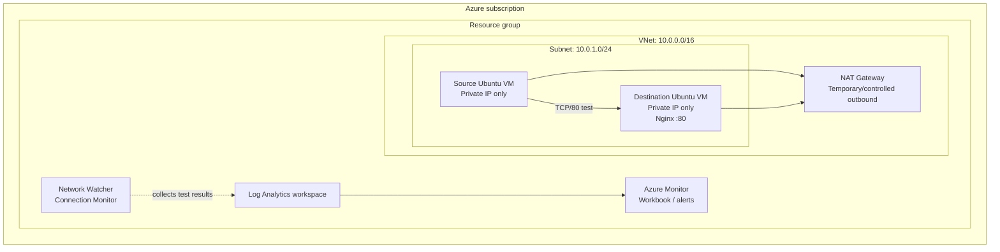

# Azure Network Performance Monitoring Lab

A hands-on Azure networking and observability project that monitors TCP connectivity between two private Linux virtual machines, records test results, and uses Azure Monitor / Log Analytics to investigate network performance and failures.

> **Project status:** Lab template. Update the evidence and completion checklist as you deploy and validate each component. Do not describe the project as completed on your resume until you have run the tests and captured your own results.

## What this project demonstrates

- Designing a private Azure virtual network and subnet
- Deploying Linux VMs without public IP addresses
- Providing controlled outbound access with an Azure NAT Gateway
- Hosting a simple Nginx service on a private destination VM
- Testing VM-to-VM connectivity over TCP/80
- Using Azure Network Watcher Connection Monitor
- Sending monitoring data to a Log Analytics workspace
- Investigating results with Kusto Query Language (KQL)
- Testing failure and recovery scenarios
- Documenting operational decisions, limitations, and cost controls

## Architecture



The NAT Gateway is used to provide outbound internet access for tasks such as installing Nginx and the Network Watcher agent. It does **not** give either VM an inbound public IP. NAT Gateway is billed while provisioned, so review the current regional price and remove it when it is no longer required. If you remove it before monitoring is complete, confirm that the required VM agent and Connection Monitor tests continue to report successfully.

## Azure resources

| Resource | Purpose |
|---|---|
| Resource group | Holds all lab resources for easy cleanup |
| Virtual network / subnet | Private network for the two VMs |
| Network security group | Allows required VNet traffic, including TCP/80 between lab VMs |
| NAT Gateway + Standard public IP | Controlled outbound internet for private VMs |
| Two Ubuntu VMs | Source and destination monitoring endpoints |
| Nginx | Simple TCP/HTTP service on the destination VM |
| Network Watcher Connection Monitor | Periodic connectivity and latency testing |
| Log Analytics workspace | Stores and queries monitoring results |
| Azure Monitor Workbook | Optional visualization of results |
| Action Group / alert rules | Optional alert notifications after query validation |

## Prerequisites

- An Azure subscription with permission to create resource groups, networking, VMs, and monitoring resources.
- Azure Cloud Shell (Bash) or Azure CLI installed locally.
- The `Microsoft.Network`, `Microsoft.Compute`, and `Microsoft.OperationalInsights` resource providers registered. Azure normally registers providers as needed, but subscription policy may restrict this.
- A region with the selected VM size available and sufficient quota.
- A valid email address if you later configure alert notifications.

Check your subscription:

```bash
az account show --output table
az account list --output table
```

If necessary, select the intended subscription:

```bash
az account set --subscription "YOUR_SUBSCRIPTION_NAME_OR_ID"
```

## Cost and safety notes

This is a learning lab, not a free-tier guarantee.

- Two running VMs incur compute charges.
- Managed OS disks continue to incur charges even when VMs are deallocated.
- NAT Gateway has an hourly charge and data-processing charges.
- A Standard public IP associated with NAT Gateway may also incur charges.
- Log Analytics ingestion, retention, Connection Monitor tests, alerts, and workbooks may incur charges depending on configuration and current pricing.
- The previous rough estimate of US$15–25 for a week did **not** fully account for the NAT Gateway. Recalculate the total using the [Azure Pricing Calculator](https://azure.microsoft.com/pricing/calculator/) before leaving the lab running.
- Create an Azure Cost Management budget and review actual costs daily. A budget sends notifications; it does not automatically stop resources.
- Do not add inbound SSH or RDP from `0.0.0.0/0`. These VMs are intentionally private.
- Never commit credentials, SSH private keys, subscription IDs, tenant IDs, connection strings, or personal email addresses.

## Repository layout

```text
azure-network-monitoring-lab/
├── README.md
├── .gitignore
├── LICENSE
├── architecture/
│   └── architecture.mmd
├── docs/
│   ├── deployment-notes.md
│   ├── troubleshooting.md
│   └── evidence-checklist.md
├── queries/
│   ├── connection-monitor-discovery.kql
│   └── connection-monitor-analysis.kql
└── scripts/
    ├── 00-set-variables.sh
    ├── 01-deploy-infrastructure.sh
    ├── 02-install-nginx.sh
    ├── 03-test-connectivity.sh
    ├── 04-remove-nat-gateway.sh
    └── 99-cleanup.sh
```

## Deployment walkthrough

Run the scripts in order from Azure Cloud Shell (Bash). The scripts are intentionally separated so you can understand each stage and troubleshoot without blindly deploying everything at once.

### 1. Set your lab variables

Open Cloud Shell → Bash. Clone your repository or upload the project folder, then:

```bash
cd azure-network-monitoring-lab
source scripts/00-set-variables.sh
```

Set `RESOURCE_GROUP` to a unique name before sourcing if you want a specific resource group:

```bash
export RESOURCE_GROUP="rg-network-monitoring-demo"
source scripts/00-set-variables.sh
```

The variables file creates a random suffix for the default resource-group name. Resource names inside that group are stable. If Cloud Shell closes, run the `source` command again and set `RESOURCE_GROUP` to the same resource group name before sourcing the file. Do not rerun the deployment script against an existing deployment unless you have checked which resources already exist.

### 2. Deploy the network, NAT Gateway, VMs, and workspace

```bash
bash scripts/01-deploy-infrastructure.sh
```

The script creates:
- Resource group
- VNet `10.0.0.0/16`
- Subnet `10.0.1.0/24`
- NSG with a TCP/80 allow rule scoped to the VNet
- NAT Gateway and Standard public IP
- Two Ubuntu VMs with no public IP addresses
- Log Analytics workspace
- Network Watcher Linux extension on the source VM

**VM size:** The default is `Standard_B2s`. If your subscription has no quota or the size is unavailable in your chosen region, edit `VM_SIZE` in `scripts/00-set-variables.sh` to a size supported by your subscription. Check current pricing before changing it.

### 3. Install Nginx on the destination VM

```bash
bash scripts/02-install-nginx.sh
```

The script uses Azure VM Run Command to install Nginx. This avoids needing SSH from your computer or a public IP on the VM. The NAT Gateway supplies outbound internet access for package downloads.

### 4. Test private TCP connectivity

```bash
bash scripts/03-test-connectivity.sh
```

This retrieves the VMs' private IPs and tests TCP port 80 from the source VM to the destination VM using Azure VM Run Command. It also checks the destination service locally.

Expected result: an HTTP response from Nginx and a successful TCP connection.

### 5. Configure Connection Monitor

Use the Azure portal:

1. Open **Network Watcher** in the Azure portal.
2. Select **Connection monitor** → **Create**.
3. Choose the lab resource group and region.
4. Add the source VM as the source endpoint.
5. Add the destination VM as the destination endpoint.
6. Configure a test using **TCP**, destination port **80**, and a conservative test frequency such as **60 seconds**.
7. Send the test results to the Log Analytics workspace created by this project.
8. Create the monitor and wait for results to appear.

Portal labels and available configuration options can change. Follow the current portal prompts if they differ. Confirm the source VM has the Network Watcher agent/extension in a healthy state. Connection Monitor may require agent installation or additional outbound connectivity depending on the VM and configuration.

### 6. Discover the actual Log Analytics schema

In the Log Analytics workspace, open **Logs** and run the queries in `queries/connection-monitor-discovery.kql`.

Do not assume every field name or result value is identical across all Connection Monitor configurations or API versions. Inspect the actual records first. Use the observed schema to adapt the analysis query and any alert conditions.

### 7. Analyze and visualize

Run the queries in `queries/connection-monitor-analysis.kql`. Create an Azure Monitor Workbook with:
- A time chart for average round-trip time, if the field is present
- A count of successful and failed tests
- A table of recent test records
- A clear time range and endpoint labels

Only create latency alerts after confirming the latency field and units in your own data. Only create failure alerts after confirming how success/failure is represented in your table.

### 8. Validate failure and recovery

Perform a controlled service failure on the destination VM:

```bash
az vm run-command invoke \
  --resource-group "$RESOURCE_GROUP" \
  --name "$DEST_VM_NAME" \
  --command-id RunShellScript \
  --scripts "sudo systemctl stop nginx"
```

Wait for Connection Monitor to record the failed TCP/80 test. Then restore the service:

```bash
az vm run-command invoke \
  --resource-group "$RESOURCE_GROUP" \
  --name "$DEST_VM_NAME" \
  --command-id RunShellScript \
  --scripts "sudo systemctl start nginx"
```

Wait for successful tests to resume. This test demonstrates **application/service reachability failure**. It does not, by itself, prove that the underlying network path failed. In your report, distinguish service failure from routing, NSG, DNS, or packet-loss issues.

For a deeper network troubleshooting exercise, temporarily add a narrowly scoped NSG deny rule for TCP/80, observe the result, and remove the rule immediately afterward. Document the exact change and recovery. Do not leave the deny rule in place.

### 9. Optional: remove NAT Gateway after package installation

If the VMs no longer need outbound internet, you can remove the NAT Gateway:

```bash
bash scripts/04-remove-nat-gateway.sh
```

This reduces ongoing NAT Gateway charges. Before doing so, check that Connection Monitor is still reporting and that the VM agent does not require outbound access for your planned tests. If the monitor stops reporting, restore outbound access and investigate the required endpoints.

### 10. Clean up all lab resources

When finished:

```bash
bash scripts/99-cleanup.sh
```

This deletes the entire resource group and everything inside it. The script asks for confirmation. This is destructive and cannot be undone. Verify the resource group name before confirming.

## Troubleshooting

See [docs/troubleshooting.md](docs/troubleshooting.md) for common issues, including:
- `apt update` cannot reach package repositories
- Nginx installs but TCP/80 tests fail
- VM Run Command fails
- Connection Monitor has no data
- KQL table or columns are missing
- VM size/quota errors
- Unexpected Azure costs

## Evidence to capture for GitHub

See [docs/evidence-checklist.md](docs/evidence-checklist.md). Capture your own screenshots after deployment:
1. Azure resource group resource list
2. VNet and subnet address spaces
3. NSG rule showing TCP/80 is limited to the VNet
4. VM overview showing private IPs and no public IPs
5. Nginx service running
6. Successful TCP connectivity test
7. Connection Monitor test configuration and healthy results
8. Log Analytics query results
9. Workbook dashboard
10. Failure and recovery results

Redact subscription IDs, tenant IDs, public IPs, personal email addresses, and any identifying information before publishing screenshots.

## Resume wording

Use this only after you have completed and validated the work:

> Built an Azure network performance monitoring lab using Azure Network Watcher Connection Monitor, Azure Monitor, and Log Analytics to assess private VM connectivity, analyze TCP reachability and latency, and validate service-failure detection and recovery through controlled testing.

If you have not implemented alerts, Workbooks, or Application Insights, do not claim that you have.

## References

- [Azure Network Watcher](https://learn.microsoft.com/azure/network-watcher/network-watcher-overview)
- [Connection Monitor overview](https://learn.microsoft.com/azure/network-watcher/connection-monitor-overview)
- [Create a Connection Monitor](https://learn.microsoft.com/azure/network-watcher/connection-monitor-create-using-portal)
- [Azure NAT Gateway overview](https://learn.microsoft.com/azure/nat-gateway/nat-overview)
- [Azure VM Run Command for Linux](https://learn.microsoft.com/azure/virtual-machines/linux/run-command)
- [Log Analytics queries](https://learn.microsoft.com/azure/azure-monitor/logs/log-analytics-overview)
- [Azure Monitor pricing](https://azure.microsoft.com/pricing/details/monitor/)
- [Azure Pricing Calculator](https://azure.microsoft.com/pricing/calculator/)

## Important scope decisions

This repository focuses on a working network-monitoring lab rather than trying to deploy every service in the original project recipe.

- **Application Insights is not provisioned by default.** Creating an Application Insights resource or writing a JSON settings file does not automatically generate application telemetry. Add it only when a real instrumented application is included.
- **NSG flow logs are not included.** Microsoft has announced retirement of NSG flow logs; use current Virtual Network flow logs guidance if you add flow logging, and verify the current service lifecycle before implementing it.
- **Packet capture is optional.** It can generate storage and operational costs. Add it only for a specific troubleshooting exercise.
- **Alerts are configured after data validation.** The alert query and threshold must match the real schema and measured baseline, not assumed column names or arbitrary thresholds.
