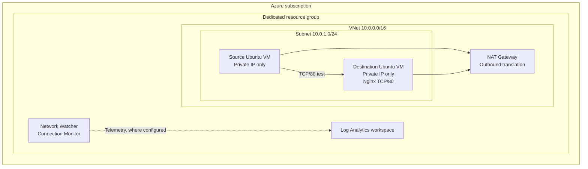

# Azure Network Performance Monitoring Lab

A hands-on Azure networking and observability project using private Linux virtual machines, NAT Gateway, Nginx, Network Watcher Connection Monitor, and Log Analytics.

> **Portfolio accuracy:** This walkthrough is written in completed-project case-study style. Replace every `[RECORD ...]` placeholder with evidence from your own deployment and remove any stage you did not complete. Do not publish unverified measurements, alerts, dashboards, or integrations as facts.

## 1. Project overview

I built an Azure environment to monitor TCP reachability between two private Linux virtual machines. One VM acted as the source of connectivity tests; the second hosted Nginx on TCP port 80. Both VMs used private IP addresses and had no public IP addresses assigned.

Azure NAT Gateway provided outbound connectivity for package installation without exposing the VMs to unsolicited inbound internet traffic. Azure Network Watcher Connection Monitor was configured for recurring TCP tests, and Log Analytics was used to inspect telemetry with Kusto Query Language (KQL).

### Objectives

- Deploy a private Azure network with two Linux endpoints.
- Enable controlled outbound connectivity without VM public IPs.
- Host a simple HTTP service as a repeatable test target.
- Monitor TCP/80 reachability over time.
- Inspect monitoring records with KQL.
- Simulate service failure and recovery.
- Document security, troubleshooting, costs, and cleanup.

## 2. Architecture



### Addressing plan

| Component | Configuration | Purpose |
|---|---|---|
| Virtual network | `10.0.0.0/16` | Private address space |
| Subnet | `10.0.1.0/24` | Hosts both VMs |
| Source VM | `[RECORD SOURCE PRIVATE IP]` | Initiates tests |
| Destination VM | `[RECORD DESTINATION PRIVATE IP]` | Hosts Nginx |
| Test endpoint | TCP `80` | HTTP connectivity target |

The VMs communicated over private addresses. The network security group allowed TCP/80 from the VNet address range rather than exposing the test service to the public internet.

### Why NAT Gateway was required

During setup, the destination VM could not download Nginx because it had no outbound internet path. A private IP address does not automatically provide outbound internet access. I associated a NAT Gateway with the subnet so the VMs could initiate outbound connections while remaining without public IP addresses.

NAT Gateway introduced additional hourly and data-processing costs. I treated it as a cost-bearing component and considered removing it after package installation, subject to verifying that monitoring continued to report.

## 3. Azure components

| Component | Purpose |
|---|---|
| Resource group | Grouped lab resources for management and teardown |
| Virtual network and subnet | Provided private connectivity |
| Network security group | Controlled subnet traffic |
| NAT Gateway and Standard public IP | Provided outbound-only internet connectivity |
| Two Ubuntu VMs | Source and destination endpoints |
| Nginx | Simple TCP/HTTP service on port 80 |
| Network Watcher Connection Monitor | Recurring connectivity tests |
| Log Analytics workspace | Monitoring data investigation with KQL |

## 4. Prerequisites and environment

I used Azure Cloud Shell with Bash and Azure CLI. The account needed permission to create resource groups, networking resources, virtual machines, and monitoring resources.

I checked the active subscription:

```bash
az account show --output table
az account list --output table
```

If necessary, I selected the intended subscription:

```bash
az account set --subscription "YOUR_SUBSCRIPTION_NAME_OR_ID"
```

I selected a region with VM size availability and sufficient vCPU quota. The scripts default to `Standard_B2s`; availability and pricing vary by region and subscription.

## 5. Implementation walkthrough

The `scripts/` directory contains repeatable infrastructure and endpoint commands. Connection Monitor setup and Log Analytics schema inspection are described as portal steps because options and telemetry schemas can vary by configuration and service version.

### Step 1 — Set deployment variables

I opened Cloud Shell in Bash and loaded the project variables:

```bash
cd azure-network-monitoring-lab
export RESOURCE_GROUP="rg-network-monitoring-demo"
source scripts/00-set-variables.sh
```

The variables file defined the region, resource group, VM names, network names, address ranges, and workspace name. Cloud Shell shell variables are temporary; after reconnecting, I sourced the file again. Azure resources persisted in the subscription.

**Validation:**

```bash
printf 'RG=%s REGION=%s VNET=%s SUBNET=%s\\n' "$RESOURCE_GROUP" "$LOCATION" "$VNET_NAME" "$SUBNET_NAME"
az account show --output table
```

### Step 2 — Deploy the network and Azure resources

I ran:

```bash
bash scripts/01-deploy-infrastructure.sh
```

The script created the resource group, VNet, subnet, NSG, NAT Gateway, Standard public IP, two Ubuntu VMs, and Log Analytics workspace. The VMs were created without public IP addresses.

The NSG included a TCP/80 inbound rule scoped to the VNet address range so the source VM could reach the destination's Nginx service.

**Why:** A dedicated resource group simplified management and cleanup. Private addressing reduced exposure, while NAT Gateway addressed the separate need for outbound package access.

**Validation:**

```bash
az group show --name "$RESOURCE_GROUP" --output table
az network vnet show -g "$RESOURCE_GROUP" -n "$VNET_NAME" --output table
az network vnet subnet show -g "$RESOURCE_GROUP" --vnet-name "$VNET_NAME" -n "$SUBNET_NAME" --output table
az vm list -d -g "$RESOURCE_GROUP" --output table
```

I confirmed both VMs had private IP addresses and no VM public IP addresses.

- Region: `[RECORD REGION]`
- Source VM private IP: `[RECORD SOURCE IP]`
- Destination VM private IP: `[RECORD DESTINATION IP]`
- VM size: `[RECORD VM SIZE]`
- Workspace: `[RECORD WORKSPACE NAME]`

### Step 3 — Install Nginx and resolve outbound access

The initial package installation failed because the VM did not have a working outbound path to public package repositories. I associated NAT Gateway with the subnet and retried installation through Azure VM Run Command:

```bash
bash scripts/02-install-nginx.sh
```

Using Run Command avoided opening SSH to the internet or assigning a public IP to the destination VM.

**Validation:**

```bash
az vm run-command invoke -g "$RESOURCE_GROUP" -n "$DEST_VM_NAME" --command-id RunShellScript --scripts "sudo systemctl is-active nginx; curl -I --max-time 5 http://127.0.0.1/"
```

The expected result was an active Nginx service and an HTTP response from the local endpoint.

### Step 4 — Verify private TCP connectivity

I ran:

```bash
bash scripts/03-test-connectivity.sh
```

The script retrieved the destination VM's private IP and tested TCP/80 from the source VM. It also made an HTTP request to the destination.

**Expected healthy baseline:** TCP connection succeeded and Nginx returned an HTTP response.

- Test date/time: `[RECORD DATE AND TIME]`
- TCP/80 result: `[RECORD PASS/FAIL]`
- HTTP response/status: `[RECORD RESULT]`
- Evidence image: `screenshots/04-private-connectivity.png`

This baseline established a known-good state before failure testing.

### Step 5 — Configure Connection Monitor

In the Azure portal, I opened **Network Watcher → Connection monitor** and created a monitor in the lab region.

I configured:
1. The source endpoint as the source Ubuntu VM.
2. The destination endpoint as the destination VM or its private IP, as supported by the selected configuration.
3. Protocol: **TCP**.
4. Destination port: **80**.
5. Test frequency: approximately **60 seconds**.
6. Log Analytics workspace destination, where supported by the selected configuration.

I saved the monitor and allowed time for recurring results to accumulate.

**Why:** A manual `curl` test only describes one moment. Connection Monitor performs repeated tests, allowing reachability and latency trends to be observed over time.

**Validation:** I confirmed the monitor and test configuration existed, the source endpoint/agent was healthy, and test results were being generated.

- Monitor name: `[RECORD MONITOR NAME]`
- Test configuration: `[RECORD TEST NAME]`
- Frequency: `[RECORD FREQUENCY]`
- Initial status: `[RECORD OBSERVED STATUS]`
- Evidence image: `screenshots/05-connection-monitor.png`

Portal capabilities and export paths can vary. I verified the workspace integration in the deployment instead of assuming that creating a workspace automatically populated it.

### Step 6 — Inspect telemetry with Log Analytics and KQL

I opened the configured Log Analytics workspace and selected **Logs**. I first ran `queries/connection-monitor-discovery.kql` to identify tables receiving records.

I inspected timestamps, endpoint identifiers, test status fields, and any available latency measurements. I then adapted `queries/connection-monitor-analysis.kql` to the table and column names actually present in the workspace.

**What I investigated:**
- Whether monitoring records were arriving.
- Whether records represented the intended endpoints.
- Whether tests succeeded or failed.
- Whether latency data was available and what unit it used.
- Whether the query time range included the baseline and failure test.

**Record actual findings:**
- Table queried: `[RECORD TABLE]`
- Timestamp field: `[RECORD FIELD]`
- Status field and values: `[RECORD FIELD / VALUES]`
- Latency field and unit, if available: `[RECORD FIELD / UNIT]`
- Observed baseline latency, if available: `[RECORD MEASUREMENT]`

Do not publish a metric until confirmed in your workspace. Connection Monitor telemetry schemas vary; schema discovery comes before writing production queries or alerts.

### Step 7 — Simulate service failure and recovery

After confirming baseline connectivity, I stopped Nginx on the destination VM:

```bash
az vm run-command invoke -g "$RESOURCE_GROUP" -n "$DEST_VM_NAME" --command-id RunShellScript --scripts "sudo systemctl stop nginx"
```

I waited for subsequent Connection Monitor tests and inspected the results. I then restarted Nginx:

```bash
az vm run-command invoke -g "$RESOURCE_GROUP" -n "$DEST_VM_NAME" --command-id RunShellScript --scripts "sudo systemctl start nginx"
```

I verified that Nginx was active and observed whether successful TCP/80 tests resumed.

**Interpretation:** Stopping Nginx demonstrates an application/service availability failure. It does not, by itself, demonstrate a routing or network-path failure. A separate, carefully scoped NSG deny-rule exercise can test network-layer blocking, but the temporary rule must be removed immediately after validation.

- Nginx stop time: `[RECORD TIME]`
- Monitor result during outage: `[RECORD RESULT]`
- Nginx restart time: `[RECORD TIME]`
- Successful tests resumed at: `[RECORD TIME]`
- Evidence image: `screenshots/06-failure-and-recovery.png`

### Step 8 — Optional Workbook and alerting

If this stage was completed, I used Azure Monitor Workbooks to visualize verified telemetry. Possible panels included test success/failure counts, a recent-results table, and latency over time where a valid latency field was available.

If alerting was implemented, I created an alert only after confirming the status field, query behavior, evaluation interval, and threshold. I associated an Action Group only if notification delivery was tested.

- Workbook: `[RECORD NAME OR N/A]`
- Alert rule/condition: `[RECORD NAME AND CONDITION OR N/A]`
- Notification test: `[RECORD RESULT OR N/A]`

Do not claim this stage unless it was actually configured and validated.

### Step 9 — Cost review and NAT Gateway removal

I reviewed usage in Azure Cost Management. Main cost contributors included VM compute while running, managed disks, NAT Gateway, its public IP, monitoring tests, and Log Analytics ingestion/retention.

Deallocating a VM stops compute billing but does not eliminate managed-disk charges. I considered removing NAT Gateway after package installation, but first checked whether monitoring and agent communication continued to work without it.

To remove the NAT Gateway association and resources:

```bash
bash scripts/04-remove-nat-gateway.sh
```

The earlier rough estimate of US$15–25 for one week was not a complete total because it did not fully include NAT Gateway and all monitoring charges. I used the Azure Pricing Calculator and actual Cost Management data for the final figure.

- Region: `[RECORD REGION]`
- Runtime: `[RECORD HOURS]`
- Actual observed cost: `[RECORD COST AND CURRENCY]`
- NAT Gateway retained or removed: `[RECORD DECISION]`

### Step 10 — Clean up

After testing, I deleted the dedicated resource group:

```bash
bash scripts/99-cleanup.sh
```

The script asks for the exact resource group name before initiating deletion. I verified removal in the Azure portal or with:

```bash
az group exists --name "$RESOURCE_GROUP"
```

## 6. Results

Complete this table using actual observations from your deployment.

| Test | Expected behavior | Actual observation |
|---|---|---|
| Baseline TCP/80 | Connection succeeds | `[RECORD RESULT]` |
| Baseline HTTP | Nginx returns a response | `[RECORD RESULT]` |
| Connection Monitor baseline | Recurring results appear | `[RECORD RESULT]` |
| Nginx stopped | TCP/80 test fails | `[RECORD RESULT]` |
| Nginx restarted | Successful tests resume | `[RECORD RESULT]` |
| Log Analytics | Records can be queried | `[RECORD RESULT]` |
| Workbook/alert | Only if implemented | `[RECORD RESULT OR N/A]` |

### Engineering takeaways

- Private addressing and outbound internet access are separate design considerations.
- NAT Gateway provided outbound connectivity without assigning public IPs to the VMs.
- A healthy baseline made failure observations easier to interpret.
- Connection Monitor provided recurring observations rather than a single point-in-time test.
- Service failure and network-path failure must be distinguished.
- KQL queries and alert conditions should be based on the actual workspace schema.
- Cost management is part of the design, especially when NAT Gateway, compute, disks, and monitoring ingestion are involved.

## 7. Repository structure

```text
azure-network-monitoring-lab/
├── README.md
├── LICENSE
├── .gitignore
├── architecture/
│   └── architecture.mmd
├── docs/
│   ├── deployment-notes.md
│   ├── troubleshooting.md
│   └── evidence-checklist.md
├── queries/
│   ├── connection-monitor-discovery.kql
│   └── connection-monitor-analysis.kql
└── scripts/
    ├── 00-set-variables.sh
    ├── 01-deploy-infrastructure.sh
    ├── 02-install-nginx.sh
    ├── 03-test-connectivity.sh
    ├── 04-remove-nat-gateway.sh
    └── 99-cleanup.sh
```

## 8. Screenshots and evidence to publish

Create a `screenshots/` directory and add redacted evidence for:
1. Resource group and deployed resources.
2. VNet address space and subnet.
3. NSG TCP/80 rule and source scope.
4. VM overview showing private IPs and no VM public IPs.
5. Nginx running.
6. Successful private TCP/80 test.
7. Connection Monitor configuration and baseline results.
8. Log Analytics discovery query and actual records.
9. Failure and recovery observations.
10. Workbook/alert validation, if implemented.
11. Cost Management summary, if appropriate.

Redact subscription IDs, tenant IDs, email addresses, public IP addresses, and other sensitive details. Never publish credentials, tokens, SSH private keys, or secrets.

## 9. Resume description

After completing the tests and replacing placeholders with verified evidence, this project can be summarized as:

> Designed and deployed an Azure network monitoring lab using private Linux VMs, Azure Virtual Network, NAT Gateway, Network Watcher Connection Monitor, and Log Analytics. Validated TCP service reachability, investigated monitoring telemetry with KQL, and performed controlled outage and recovery testing.

Adjust the wording to match the features actually implemented. Do not claim production deployment, measured performance improvements, alerting, Workbooks, or Application Insights unless they were configured and tested.

## 10. Scope and references

This lab focuses on network reachability and service monitoring.

- **Application Insights is not included by default.** It requires a real instrumented application; creating the resource alone does not generate meaningful application telemetry.
- **NSG flow logs are not included.** Review Microsoft's current flow logging lifecycle and guidance before adding flow logs; Virtual Network flow logs are the current direction.
- Packet capture, Workbooks, and alerts are optional extensions and should be added only when there is a clear objective and verified evidence.

References:
- [Azure Network Watcher overview](https://learn.microsoft.com/azure/network-watcher/network-watcher-overview)
- [Connection Monitor overview](https://learn.microsoft.com/azure/network-watcher/connection-monitor-overview)
- [Create a Connection Monitor](https://learn.microsoft.com/azure/network-watcher/connection-monitor-create-using-portal)
- [Azure NAT Gateway overview](https://learn.microsoft.com/azure/nat-gateway/nat-overview)
- [Run commands on Linux VMs](https://learn.microsoft.com/azure/virtual-machines/linux/run-command)
- [Log Analytics overview](https://learn.microsoft.com/azure/azure-monitor/logs/log-analytics-overview)
- [Azure Monitor pricing](https://azure.microsoft.com/pricing/details/monitor/)
- [Azure Pricing Calculator](https://azure.microsoft.com/pricing/calculator/)
