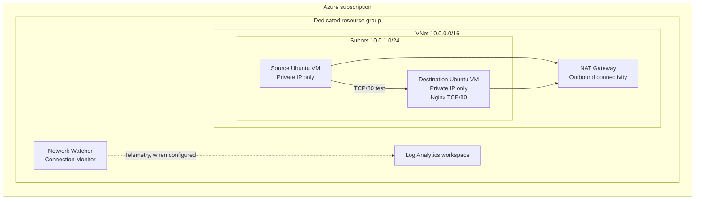

# Azure Network Performance Monitoring Lab

I built this lab to test connectivity between two private Linux virtual machines in Azure. The setup uses a source VM, a destination VM running Nginx, Network Watcher Connection Monitor, and Log Analytics.

The main goal was to get familiar with Azure network monitoring and understand what the monitoring data tells you when a service becomes unavailable.

This README follows the stages of the build. It explains the choices, commands, and checks used at each point. Replace the `[ADD ...]` fields with details from your own deployment. The scripts have been checked for Bash syntax, but they have not been tested end to end against an Azure subscription. Do not treat an expected result as a recorded result.

## What I built

- One Azure virtual network with a single subnet.
- Two Ubuntu VMs using private IP addresses.
- An NSG rule allowing the source VM to reach the destination on TCP/80.
- A NAT Gateway for outbound package access.
- Nginx on the destination VM.
- Network Watcher Connection Monitor for recurring TCP tests.
- A Log Analytics workspace for investigating monitoring data with KQL.

The source VM sends the connectivity tests. The destination VM hosts a basic web service. This gives the monitor a clear target and makes it easier to repeat the same test during normal operation and an outage.

## Architecture



### Address plan

| Resource | Address or setting | Role |
|---|---|---|
| Virtual network | `10.0.0.0/16` | Private network |
| Subnet | `10.0.1.0/24` | Hosts both VMs |
| Source VM | `[ADD SOURCE PRIVATE IP]` | Starts the test |
| Destination VM | `[ADD DESTINATION PRIVATE IP]` | Runs Nginx |
| Service | TCP/80 | Connectivity test target |

Both VMs use private IPs. Neither VM needs a public IP for this lab.

## Why I chose these components

| Component | Reason |
|---|---|
| Resource group | Keeps the lab resources together and makes cleanup easier. |
| VNet and subnet | Give the VMs a private network in which to communicate. |
| NSG | Limits access to the test service. |
| NAT Gateway | Gives the VMs outbound internet access without assigning public IPs to them. |
| Ubuntu VMs | Provide two endpoints for the connectivity test. |
| Nginx | Gives the destination a simple service to monitor. |
| Connection Monitor | Runs recurring connectivity tests instead of relying on one manual check. |
| Log Analytics | Lets me inspect the monitoring records with KQL. |

## Prerequisites

I used Azure Cloud Shell with Bash and Azure CLI. The account needs permission to create resource groups, virtual machines, networking resources, and monitoring resources.

Check the active subscription:

```bash
az account show --output table
az account list --output table
```

Select the subscription for the lab if needed:

```bash
az account set --subscription "YOUR_SUBSCRIPTION_NAME_OR_ID"
```

The deployment script defaults to `Standard_B2s`. Check VM availability and vCPU quota in your chosen region before running the deployment. Azure prices also vary by region and subscription.

## Stage 1: Set the deployment variables

I kept the main settings in one file so I would not have to repeat resource names and address ranges across commands.

From the project directory, I loaded the variables:

```bash
cd azure-network-monitoring-lab
export RESOURCE_GROUP="rg-network-monitoring-demo"
source scripts/00-set-variables.sh
```

The file defines the region, resource group, VM names, VNet, subnet, address ranges, and workspace name.

Cloud Shell variables do not persist after a new session. The Azure resources do. If Cloud Shell disconnects, set the resource group name again and source the file before continuing.

Check the values:

```bash
printf 'RG=%s REGION=%s VNET=%s SUBNET=%s\n' "$RESOURCE_GROUP" "$LOCATION" "$VNET_NAME" "$SUBNET_NAME"
az account show --output table
```

Expected check: the subscription and resource names match the lab you intend to use.

## Stage 2: Deploy the Azure resources

I used the deployment script to create the resource group, VNet, subnet, NSG, NAT Gateway, public IP for the NAT Gateway, two Ubuntu VMs, and Log Analytics workspace.

```bash
bash scripts/01-deploy-infrastructure.sh
```

The VMs are created without public IP addresses. The NSG allows TCP/80 from the VNet address range so the source VM can reach Nginx on the destination.

I used a dedicated resource group to keep the lab separate from other Azure resources. This also makes it easier to remove the environment when testing is finished.

Check the deployment:

```bash
az group show --name "$RESOURCE_GROUP" --output table
az network vnet show -g "$RESOURCE_GROUP" -n "$VNET_NAME" --output table
az network vnet subnet show -g "$RESOURCE_GROUP" --vnet-name "$VNET_NAME" -n "$SUBNET_NAME" --output table
az vm list -d -g "$RESOURCE_GROUP" --output table
```

Confirm both VMs have private IP addresses and no VM public IP addresses.

Record your deployment details:

- Region: `[ADD REGION]`
- Source VM private IP: `[ADD IP]`
- Destination VM private IP: `[ADD IP]`
- VM size: `[ADD SIZE]`
- Log Analytics workspace: `[ADD WORKSPACE NAME]`

## Stage 3: Set up outbound access and install Nginx

The first package installation attempt failed because the VM had no working route to the public package repositories. A private IP address does not automatically give a VM outbound internet access.

I attached a NAT Gateway to the subnet. The VMs kept their private IP addresses, while the NAT Gateway handled outbound translation for connections initiated from the subnet. The NAT Gateway uses a public IP of its own. The VMs do not.

NAT Gateway adds to the cost of the lab, so I treated it as a temporary requirement and included its removal in the cleanup options.

I then ran the Nginx installation script:

```bash
bash scripts/02-install-nginx.sh
```

The script uses Azure VM Run Command. This avoids opening SSH to the internet or giving the destination VM a public IP.

Check the service:

```bash
az vm run-command invoke \
  -g "$RESOURCE_GROUP" \
  -n "$DEST_VM_NAME" \
  --command-id RunShellScript \
  --scripts "sudo systemctl is-active nginx; curl -I --max-time 5 http://127.0.0.1/"
```

Expected result: `systemctl` reports `active`, and the local HTTP request returns a response from Nginx.

Record the result: `[ADD COMMAND OUTPUT OR SCREENSHOT]`.

## Stage 4: Test connectivity between the VMs

With Nginx running, I tested the service from the source VM using the destination VM's private IP address.

```bash
bash scripts/03-test-connectivity.sh
```

The script retrieves the destination's private IP, checks whether TCP/80 accepts a connection, and sends an HTTP request.

A successful test confirms the source VM can reach the destination service over the private network. It also gives me a baseline to compare against during the failure test.

Record the result:

- Test date and time: `[ADD DATE AND TIME]`
- TCP/80: `[ADD PASS OR FAIL]`
- HTTP response: `[ADD STATUS OR OUTPUT]`
- Screenshot: `screenshots/04-private-connectivity.png`

## Stage 5: Configure Network Watcher Connection Monitor

A manual connection test only shows what happened at one point in time. I wanted recurring checks, so I configured Connection Monitor in Azure Network Watcher.

In the Azure portal, I opened Network Watcher, selected Connection monitor, and created a monitor in the same region as the lab.

I configured the test with these settings:

1. Source: the source Ubuntu VM.
2. Destination: the destination VM or its private IP, depending on the endpoint options available.
3. Protocol: TCP.
4. Destination port: 80.
5. Test frequency: approximately 60 seconds.
6. Log Analytics workspace: selected the lab workspace where the integration option was available.

I saved the monitor and allowed it to run before starting the failure test.

The important checks were that the monitor existed, the source endpoint was healthy, and test results started appearing. Creating a workspace alone does not prove Connection Monitor is sending data to it, so I checked the workspace rather than assuming the integration worked.

Record the configuration and observed status:

- Monitor name: `[ADD NAME]`
- Test configuration: `[ADD NAME]`
- Frequency: `[ADD FREQUENCY]`
- Initial status: `[ADD OBSERVED STATUS]`
- Screenshot: `screenshots/05-connection-monitor.png`

## Stage 6: Review the monitoring data with KQL

I opened the Log Analytics workspace and selected Logs. Before writing an analysis query, I checked which tables were receiving data.

I started with the discovery query in `queries/connection-monitor-discovery.kql`. After identifying the relevant table, I inspected its columns and sample records. I then updated `queries/connection-monitor-analysis.kql` to match the schema in the workspace.

I looked for:

- Records from the expected source and destination.
- The time each test ran.
- The test result or connection status.
- Latency fields, if the selected data source included them.

The table and column names depend on the Connection Monitor configuration and the data being sent to the workspace. For this reason, the analysis query is a template. Check the schema before using it. Do not assume a latency field or status value without confirming the records.

Record what you found:

- Table: `[ADD TABLE NAME]`
- Timestamp column: `[ADD COLUMN]`
- Status column and values: `[ADD COLUMN AND VALUES]`
- Latency column and unit, if present: `[ADD COLUMN AND UNIT]`
- Baseline measurement, if available: `[ADD OBSERVED VALUE]`

## Stage 7: Stop Nginx and test recovery

Once the baseline test was working, I stopped Nginx on the destination VM.

```bash
az vm run-command invoke \
  -g "$RESOURCE_GROUP" \
  -n "$DEST_VM_NAME" \
  --command-id RunShellScript \
  --scripts "sudo systemctl stop nginx"
```

I waited for the next Connection Monitor tests and checked their results. I then started Nginx again:

```bash
az vm run-command invoke \
  -g "$RESOURCE_GROUP" \
  -n "$DEST_VM_NAME" \
  --command-id RunShellScript \
  --scripts "sudo systemctl start nginx"
```

I checked the service state and watched for successful TCP/80 tests to return.

This test demonstrates a service availability problem. Stopping Nginx does not prove the network path itself has failed. The VM and network can still be reachable while the application listening on port 80 is unavailable.

A separate NSG rule test would demonstrate network-layer blocking. If you run one, scope the deny rule to the test traffic, record the change, and remove the rule as soon as the test ends.

Record the results:

- Nginx stop time: `[ADD TIME]`
- Monitor result during outage: `[ADD RESULT]`
- Nginx restart time: `[ADD TIME]`
- Successful tests resumed: `[ADD TIME OR RESULT]`
- Screenshot: `screenshots/06-failure-and-recovery.png`

## Stage 8: Optional Workbook and alert

A Workbook or alert is an optional extension. I would add one only after confirming the table, fields, and status values in Log Analytics.

A Workbook might show recent test results, success and failure counts, or latency over time if the data includes a suitable latency field. An alert needs a tested query, evaluation period, threshold, and Action Group. Notification delivery should also be tested.

Record this stage only if you completed it:

- Workbook: `[ADD NAME OR N/A]`
- Alert rule and condition: `[ADD DETAILS OR N/A]`
- Notification test: `[ADD RESULT OR N/A]`

## Stage 9: Review costs and remove NAT Gateway

The main cost items for this lab are VM compute, managed disks, NAT Gateway, its public IP, Connection Monitor tests, and Log Analytics ingestion and retention.

Deallocating a VM stops compute charges, but managed disks continue to incur charges. NAT Gateway also has hourly and data-processing costs while deployed.

I included a script to detach and remove the NAT Gateway after package installation:

```bash
bash scripts/04-remove-nat-gateway.sh
```

Before removing it, check whether the monitoring setup needs outbound connectivity for agents or other components. Confirm monitoring still works after removal if you choose this route.

The earlier US$15 to US$25 estimate for one week was not a full project total. It did not fully account for NAT Gateway and all monitoring charges. Use the Azure Pricing Calculator before deployment and Cost Management for the actual amount billed.

Record your costs:

- Region: `[ADD REGION]`
- Runtime: `[ADD HOURS]`
- Cost shown in Cost Management: `[ADD AMOUNT AND CURRENCY]`
- NAT Gateway: `[RETAINED OR REMOVED]`

## Stage 10: Delete the lab

When testing is complete, remove the dedicated resource group:

```bash
bash scripts/99-cleanup.sh
```

The script asks you to confirm the exact resource group name before it starts deletion.

Check whether the resource group still exists:

```bash
az group exists --name "$RESOURCE_GROUP"
```

A result of `false` means Azure no longer finds the resource group.

## Results

Fill in this table with the results from your own deployment. Keep the evidence with the repository so someone reviewing the project can follow what you tested.

| Test | What I expected | What happened |
|---|---|---|
| TCP/80 baseline | Connection succeeds | `[ADD RESULT]` |
| HTTP baseline | Nginx returns a response | `[ADD RESULT]` |
| Connection Monitor | Recurring test results appear | `[ADD RESULT]` |
| Nginx stopped | Service test fails | `[ADD RESULT]` |
| Nginx restarted | Successful tests return | `[ADD RESULT]` |
| Log Analytics | Monitoring records are queryable | `[ADD RESULT]` |
| Workbook or alert | Only if configured | `[ADD RESULT OR N/A]` |

## What I took away from the build

- Private addressing and outbound internet access are separate parts of the network design.
- NAT Gateway solved the package download issue without assigning public IPs to the VMs.
- A baseline test made the outage results easier to compare.
- Connection Monitor gave me recurring test results instead of a single manual check.
- A stopped service and a broken network path are different failure conditions.
- KQL queries and alert rules need to match the data actually present in the workspace.
- Azure monitoring resources add to the project cost, so cleanup matters.

## Repository structure

```text
azure-network-monitoring-lab/
├── README.md
├── LICENSE
├── .gitignore
├── architecture/
│   └── architecture.mmd
├── docs/
│   ├── deployment-notes.md
│   ├── troubleshooting.md
│   └── evidence-checklist.md
├── queries/
│   ├── connection-monitor-discovery.kql
│   └── connection-monitor-analysis.kql
└── scripts/
    ├── 00-set-variables.sh
    ├── 01-deploy-infrastructure.sh
    ├── 02-install-nginx.sh
    ├── 03-test-connectivity.sh
    ├── 04-remove-nat-gateway.sh
    └── 99-cleanup.sh
```

## Screenshots and evidence

Create a `screenshots/` folder and add redacted screenshots of:

1. The resource group and deployed resources.
2. The VNet address space and subnet.
3. The NSG rule for TCP/80.
4. Both VMs showing private IP addresses and no VM public IPs.
5. Nginx running on the destination.
6. The successful private connectivity test.
7. Connection Monitor settings and baseline results.
8. The KQL query and records returned by Log Analytics.
9. The Nginx outage and recovery results.
10. Workbook or alert results, if you built them.
11. Cost Management, if you want to include the cost breakdown.

Hide subscription IDs, tenant IDs, email addresses, public IP addresses, and other details you do not want to share. Never commit passwords, tokens, SSH private keys, or other secrets.

## Resume summary

Use this only after completing the tests and adding your evidence:

> Built an Azure network monitoring lab using private Linux VMs, Azure Virtual Network, NAT Gateway, Network Watcher Connection Monitor, and Log Analytics. Tested TCP service reachability, reviewed monitoring data with KQL, and performed service outage and recovery checks.

Change the wording to match the work you completed. Do not list Workbooks, alerts, measured performance improvements, or other features unless you configured and tested them.

## Scope and references

This project focuses on private network connectivity and service monitoring.

- Application Insights is not part of the base lab. A real instrumented application is needed to produce useful application telemetry.
- NSG flow logs are not part of this build. Check Microsoft's current guidance before adding flow logs. Virtual Network flow logs are the recommended direction.
- Workbooks, alerts, and packet capture are optional additions. Add them when you have a clear test case and evidence.

References:

- [Azure Network Watcher overview](https://learn.microsoft.com/azure/network-watcher/network-watcher-overview)
- [Connection Monitor overview](https://learn.microsoft.com/azure/network-watcher/connection-monitor-overview)
- [Create a Connection Monitor](https://learn.microsoft.com/azure/network-watcher/connection-monitor-create-using-portal)
- [Azure NAT Gateway overview](https://learn.microsoft.com/azure/nat-gateway/nat-overview)
- [Run commands on Linux VMs](https://learn.microsoft.com/azure/virtual-machines/linux/run-command)
- [Log Analytics overview](https://learn.microsoft.com/azure/azure-monitor/logs/log-analytics-overview)
- [Azure Monitor pricing](https://azure.microsoft.com/pricing/details/monitor/)
- [Azure Pricing Calculator](https://azure.microsoft.com/pricing/calculator/)
